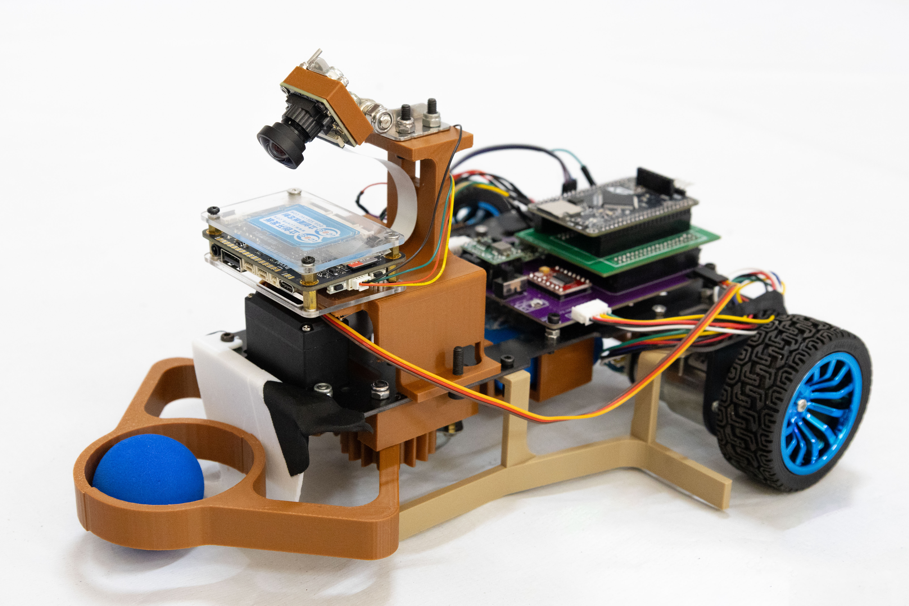
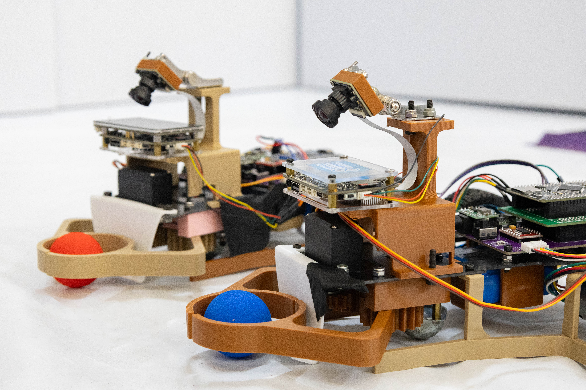
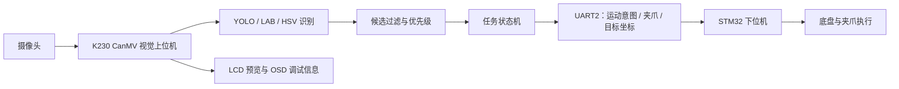

# 2026工创赛智能救援小车上位机方案开源

记录 2026 年工创赛智能救援小车视觉上位机的开发过程，使用 **K230 CanMV / MicroPython** 实现目标识别、抓取决策、安全区运输与卸载，并通过 **UART 与 STM32 下位机**协同控制小车。

仓库保留从 YOLO 球类控制、LAB 色块实验，到 YOLO + OpenCV HSV 决赛物料融合的 **31 个 Python 脚本**，以及版本演进说明、现场测试日志、比赛资料和小车照片。

<table>
  <tr>
    <td align="center"><br>单车结构</td>
    <td align="center"><br>双车展示</td>
  </tr>
</table>

## 从哪里开始

| 想了解的内容 | 建议入口 |
|---|---|
| YOLO 控制系列末版 | [vision_V8.9.py](src/yolo/vision_V8.9.py) |
| V8.9 的完整运行流程、状态机与全部方法实现 | [V8.9 专项说明](docs/README_V8.9.md) |
| 决赛融合控制系列最高版本号 | [vision_final_V2.3.py](src/final/vision_final_V2.3.py) |
| 同时启用黑方块、黄锥控制候选的决赛配置 | [vision_final_V2.1.py](src/final/vision_final_V2.1.py) |
| 不发送底盘/夹爪命令的融合识别实验 | [物料识别测试 v1.4](experiments/material/k230_yolo_cv2_final_material_test_v1.4.py) |
| 各版本何时保存、改了什么、如何演进 | [版本时间线](docs/CODE_VERSION_TIMELINE.md) · [完整线性图](docs/代码版本线性图.svg) |

**版本选择说明：** V8.9 与决赛 V2.x 属于并行保留的控制系列。V8.9 的原文件修改时间最晚，V2.3 是决赛系列最高版本号；现有资料不足以确认实际比赛启动版。仓库导入保留原脚本内容，历史日期见版本文档，不把导入提交时间当作开发时间。

## 主要功能

- **目标识别：** YOLO 检测红/蓝球及安全区；决赛融合版本加入 LAB 或 HSV 非球形物料识别。
- **目标选择：** 首件任务优先完成本方普通球抓取，排除对方普通球与安全区内目标，按版本配置决定后续优先级。
- **抓取控制：** 依据目标位置、夹爪 ROI、连续帧和动作计时完成靠近、开爪、闭爪与抓取复核。
- **运输卸载：** 向下位机发送安全区中心坐标，到位或满足近区超时兜底后执行卸载，再进入搜索冷却。
- **脱困恢复：** 部分控制版本通过图像差分判断持续静止，执行停车、后退和转向挣脱。
- **现场工具：** 提供数据采集、HSV 阈值标定、LAB 色块识别及双通路融合实验脚本。

## 硬件与处理流程



上位机负责视觉和任务决策，轮速 PID、舵机驱动等执行细节由下位机完成。仓库仅包含 K230 端代码和相关资料，不包含 STM32 工程。

### 两条控制路线

| 系列 | 识别方式 | 任务对象与版本特点 |
|---|---|---|
| YOLO V7.7～V8.9 | YOLOv5 | 红/蓝普通球、黑色核心球、黄色危险球；逐步加入坐标修正、抓取复核、运输兜底和防堵停 |
| 决赛 V1.0 | YOLO + LAB `find_blobs` | YOLO 球体优先，LAB 补充红/蓝/黄非球形目标，接入完整控制流程 |
| 决赛 V2.0～V2.3 | YOLO + OpenCV HSV | YOLO 识别红/蓝球与安全区，HSV 检测黑方块/黄色三棱锥，并迭代近场抓取策略 |

注意同名类型的物理含义：`CORE` 在 YOLO 控制系列指黑球，在决赛 HSV 系列指黑方块；`DANGER` 分别指黄球与黄色三棱锥。

### 当前保存配置需要留意

- **V8.9：** `TEAM_COLOR="RED"`，本方球权重 20、黄球 5、黑球 1；首个本方普通球复核成功后才放开后续类别。黑球闭爪等待结束后会进入 `VERIFY_GRAB`，但直接绕过视觉确认。
- **决赛 V2.1：** `TEAM_COLOR="BLUE"`，`CV_MATERIAL_ORDER=("CORE", "DANGER")`，同时启用黑方块和黄锥控制候选。
- **决赛 V2.2 / V2.3：** 当前 `CV_MATERIAL_ORDER=("DANGER",)`，仅选择黄色 CV 物料。虽仍保留黑色检测代码，部分注释和启动提示也仍写着黑方块优先，但不代表黑方块已启用控制选择。
- **V2.3：** CV 框底中心进入独立 `CV_GRAB_ROI` 连续 3 帧后闭爪，完成闭爪等待即进入运输；YOLO 球继续使用视觉复核流程。

## 仓库结构

```text
.
├── README.md
├── .gitignore
├── src/
│   ├── yolo/                  11 个 YOLO 控制版本
│   └── final/                 5 个决赛融合控制版本
├── tools/
│   ├── capture/               2 个自动采图脚本
│   └── hsv_calibration/       3 个 HSV 标定工具
├── experiments/
│   ├── cv2/                   OpenCV 兼容性与多色色块测试，2 个
│   ├── lab/                   LAB 与 YOLO+LAB 实验，3 个
│   └── material/              决赛物料融合识别测试 v1.0～v1.4，5 个
├── docs/
│   ├── README_V8.9.md         V8.9 流程、33 个函数/方法与源码行号
│   ├── CODE_VERSION_TIMELINE.md
│   ├── 代码版本线性图.svg
│   └── rules/                规则 PDF 与决赛要求图片
├── tests/
│   └── field_records/        5 类现场测试的截图和日志，26 个文件
└── assets/
    └── photos/               2 张代表性小车照片
```

脚本以独立单文件方式保存，各控制版本是历史快照，不需要按顺序依次运行。目录重组不改变 31 个脚本的文件名与内容；原始文件日期与 SHA-256 指纹保存在版本文档中。

## 如何运行

### 1. 准备开发板环境

使用 K230 CanMV 开发板、摄像头、适配显示屏及 CanMV IDE。脚本依赖固件提供的 `image`、`media.sensor`、`media.display`、`media.media`、`machine.UART/FPIOA`、`ulab.numpy`、`libs.YOLO` 和 `libs.Utils`；早期版本与采集工具还使用 `libs.PipeLine`，HSV 路线另需 `cv2`。

已有现场日志记录的环境为 `CanMV v1.8-0-gc2d1f5c`、`k230_canmv_v3p0 with K230`，可作为复现线索。接口是否可用仍需在所用固件上验证。这些是开发板脚本，不能用桌面 Python 加 `pip install opencv-python` 直接替代运行。

### 2. 准备模型并核对配置

默认模型路径为开发板上的 `/sdcard/model/best_0719.kmodel`，模型输入 `[320, 320]`。本开源项目暂不包含模型文件、训练数据、训练工程和转换工具；需自行准备与脚本类别顺序匹配的模型并修改 `KMODEL_PATH`。

```python
labels = [
    "redball", "blueball", "redboard", "blueboard", "redsection",
    "bluesection", "shizi", "redcube", "bluecube", "greenzhu",
    "yellowtai", "blackball", "yellowball",
]
```

启动前核对选定脚本的 `TEAM_COLOR`、摄像头编号、显示配置、夹爪 ROI、物料顺序和动作时间。V8.9 与决赛 V2.3 当前队伍颜色不同，不要直接沿用另一个版本的配置。

### 3. 先检查识别通路

1. 运行 [OpenCV 兼容性测试](experiments/cv2/k230_cv2_compat_test.py)，核对 HSV 路线所需 API 与图像转换。
2. 按现场光照选择 [基础标定](tools/hsv_calibration/k230_cv2_hsv_calibration.py)、[交互快速标定](tools/hsv_calibration/k230_cv2_hsv_quick_calibration.py)或[屏幕引导标定](tools/hsv_calibration/k230_cv2_hsv_guided_calibration.py)。后两者会输出开发板文件 `/sdcard/hsv_calibration.txt`，阈值需人工同步到实际运行脚本。
3. 运行 [独立物料识别测试 v1.4](experiments/material/k230_yolo_cv2_final_material_test_v1.4.py)，观察目标类别、位置、优先级、安全区过滤与耗时；这类实验不初始化 UART、不驱动底盘和夹爪。
4. 如果选择 LAB 路线，从 [蓝色色块测试](experiments/lab/k230_lab_find_blobs_blue_test.py)开始，再查看[多色实验](experiments/lab/k230_lab_find_blobs_multicolor_test.py)和[双通路实验](experiments/lab/k230_yolo_lab_dual_path_test.py)。

### 4. 运行选定控制版本

通过 CanMV IDE 单独打开所需脚本并在开发板运行。控制版本会在顶层初始化硬件并进入无限循环，不适合当作普通 Python 模块导入。

V8.9 可配合 [专项说明](docs/README_V8.9.md)逐步核对；决赛融合版本按当前启用物料和抓取策略选择。完整控制版会向 STM32 发送实际运动与夹爪命令。

### 串口连接与协议

V8.9 的 UART2 使用引脚 11（TX）和 12（RX），115200 波特率、8N1。应与实际下位机接线和接收实现一致。

```text
55 | 0D | sign(2B) | angle(2B) | pos_x(2B) | pos_y(2B) | CRC16(2B) | AA

sign = vision_mode × 100 + move_cmd × 10 + grip_action
```

四个载荷字段为大端；CRC16 对前 10 字节计算，初值 `0xFFFF`、多项式 `0xA001`，CRC 低字节先写。`NONE/BALL_XY/SAFE_XY` 对应普通控制、球坐标控制和安全区坐标控制。源码提到的下位机 `Buffer_usart.c` 未包含在仓库中；完整打包逻辑及发送条件见 [V8.9 说明第 7 节](docs/README_V8.9.md#7-串口命令怎样打包怎样与下位机配合)。

## 采图与调参工具

| 工具 | 保存内容 / 使用场景 |
|---|---|
| [get_video_yolo.py](tools/capture/get_video_yolo.py) | 默认每秒 1 张，实时 YOLO 画框，原始 RGBP888 数据保存到开发板 `/data/dataset/*.bin` |
| [get_video_yolo_dual_save_live_box.py](tools/capture/get_video_yolo_dual_save_live_box.py) | 默认每秒 2 组，原始图与画框图分别保存到 `/data/dataset/raw/`、`/data/dataset/boxed/`，同名成对 |
| [HSV 标定工具](tools/hsv_calibration/) | 输出颜色统计与建议阈值，适应现场光照 |

`.bin` 是原始图像张量，不是 JPG；注释提及的 BIN→JPG 转换脚本不在仓库中。

## 现场测试与验证范围

[现场记录](tests/field_records/)保留 17 张截图和 9 份文本日志，覆盖五类场景：

| 场景 | 记录内容 |
|---|---|
| 优先级切换 | 本方球、黑方块、黄锥依次移除，以及只保留对方球 |
| 近距离夹爪区域 | 黑/黄物料在夹爪附近的识别情况 |
| 运动稳定性 | 运动过程的候选框与识别输出 |
| 多黑方块分离 | 多目标分离与筛选 |
| 安全区过滤 | 安全区内候选的排除 |

九份文本日志的版本标题均为 **独立物料识别测试 v1.1**，不能作为后续控制版已通过整车闭环验证的依据。仓库整理检查覆盖源码完整性、文档引用、语法解析和版本记录一致性；没有重新连接小车进行实机验证。

## 版本记录与比赛资料

- [完整版本说明](docs/CODE_VERSION_TIMELINE.md)：全部脚本的原始修改日期、功能差异、演进依据和源码指纹。
- [代码版本线性图](docs/代码版本线性图.svg)：按原始修改时间排列，箭头表示时间顺序，不能直接视作 Git 父子提交关系。
- [V8.9 实现详解](docs/README_V8.9.md)：七状态全流程、33 个函数/方法、串口协议、关键变量与代码行号。
- [比赛规则 PDF](docs/rules/救援小车规则.pdf)与[决赛要求图片](docs/rules/2026年广东大学生工程实践决赛要求/)。

现存代码修改时间集中在 2026-07-20～2026-07-23。V2.3 的修改时间早于 V2.2，部分系列也存在功能与保存顺序不一致的情况，文档中保留了这些差异，没有据此补造缺失版本或开发提交。
