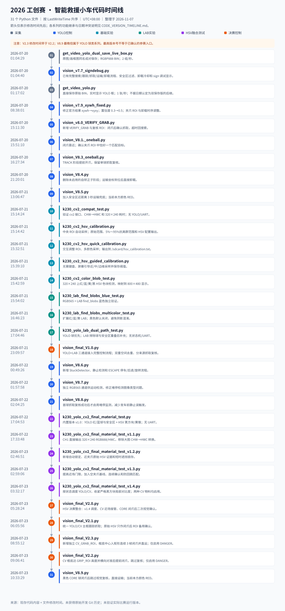
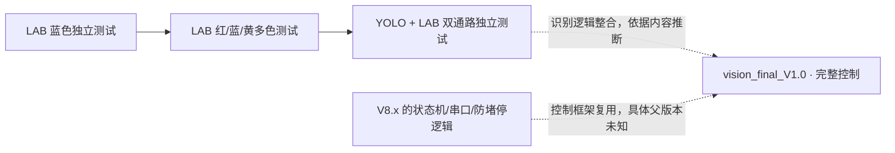
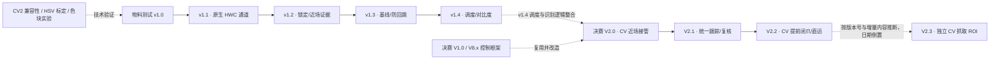

# 代码版本时间线与演进依据

整理日期：2026-11-07。覆盖原始资料中的全部 **31 个 Python 文件**（11 个 YOLO 控制版、5 个决赛控制版、13 个识别/标定实验、2 个采集工具）。[返回总 README](../README.md) · [打开完整 SVG 线性图](代码版本线性图.svg)

## 如何理解这条时间线

- **日期**取文件系统 `LastWriteTime` 对应的时刻，以 UTC+08:00 展示，精确到秒。它说明当前文件最后修改时间，不能证明首次编写时间、实机运行时间或版本继承关系。复制、同步与后续调参都可能影响它。
- **功能**由文件头注释、实际函数、配置和相邻版本差异交叉核对。代码执行实值优先于旧注释/启动打印。
- **演进箭头**是内容和命名支持的整理顺序，不是 Git 提交父子关系。整理前的原始资料目录未提供可用 Git 历史；仓库导入提交记录整理后的快照，不能作为原始开发提交历史。
- 多个旧版文件头保留 `2026.6.25`，采集前缀也有 `img_6.22_`；这些是内容线索，不能覆盖文件系统日期。现存代码修改时间集中在 **2026-07-20～2026-07-23**。
- V7.8、V8.2 未发现文件，不为它们虚构节点。目录中规则 PDF 的修改时间为 2026-04-16，属于资料，不作为代码版本起点。

## 1. 按文件修改时间排列的总线性图

下图包含所有 31 个脚本。箭头仅表示修改时间从早到晚；不同颜色代表不同系列，**不代表前一个文件直接生成后一个文件**。

## 2. 按代码内容整理的系列演进

### YOLO 球类控制系列

```mermaid
flowchart LR
    A["V7.7 · sign 调试/安全区过滤"] --> B["V7.9 · xywh 修正"]
    B --> C["V8.0 · VERIFY_GRAB"]
    C --> D["V8.1 · 单球复核/闭爪靠近"]
    D --> E["V8.3 · 提前开爪"]
    E --> F["V8.4 · 运输直接卸载"]
    F --> G["V8.5 · 近区 3 秒兜底"]
    G --> H["V8.6 · 防堵停/ESCAPE"]
    H --> I["V8.7 · RGB565 检测修正"]
    I --> J["V8.8 · 首球后使能防堵停"]
    J --> K["V8.9 · CORE 球跳过复核"]
```

这条线的 V8.9 仍是 YOLO 球类控制版，没有接入决赛 HSV 黑方块检测，不能把它理解成决赛 V2.3 的升级版。

### LAB 识别验证 → 决赛融合 V1.0

决赛 V1.0 文件时间为 07-21 23:09:57，早于现存 V8.6 的 07-22 00:49:26，但已经带有 `StuckDetector`、`ESCAPE`，头部也提到 V8.6。因此能确认共享了 V8.x 的防堵停思路，不能单靠日期断定“当前 V8.6 文件在先、V1.0 在后”。函数 AST 对比中，V1.0 与 V8.6/V8.7 均有 30 个同名顶层函数/类，其中 24 个结构相同（忽略注释和行号）；这支持框架复用，但不能确定唯一父版本。

### HSV 验证 → 决赛融合 V2.x

HSV 标定的基础版→交互快速版→屏幕引导版反映交互方式扩展；色块测试与 LAB 测试是并行验证路线，不应被强行串成一个产品发布序列。两个采集工具也独立保留：双保存版修改时间反而更早，不能按功能多少猜测先后。

## 3. 完整文件日期与功能清单

下表严格按修改时间升序排列，与 SVG 节点编号一致。行数包括注释和空行。

| 序号 | 修改时间（UTC+08:00） | 文件 | 系列 | 行数 | 主要内容 / 相邻版本变化 |
|---|---|---|---|---:|---|
| 01 | 2026-07-20 01:04:29 | [get_video_yolo_dual_save_live_box.py](../tools/capture/get_video_yolo_dual_save_live_box.py) | 采集 | 574 | 原图/画框图同名成对保存；RGBP888 BIN；2 组/秒。 |
| 02 | 2026-07-20 01:04:40 | [vision_v7.7_signdebug.py](../src/yolo/vision_v7.7_signdebug.py) | YOLO控制 | 1206 | 已有完整搜索/跟踪/抓取/运输/卸载流程、安全区过滤、卸载冷却和 sign 调试显示。 |
| 03 | 2026-07-20 01:17:02 | [get_video_yolo.py](../tools/capture/get_video_yolo.py) | 采集 | 216 | 直接保存原始 BIN，实时显示 YOLO 框；1 张/秒；不据日期认定为双保存版的后继。 |
| 04 | 2026-07-20 08:38:01 | [vision_v7.9_xywh_fixed.py](../src/yolo/vision_v7.9_xywh_fixed.py) | YOLO控制 | 1217 | 修正官方结果 xywh→xyxy；置信度 0.3→0.5；夹爪 ROI 与卸载时序调整。 |
| 05 | 2026-07-20 15:11:30 | [vision_v8.0_VERIFY_GRAB.py](../src/yolo/vision_v8.0_VERIFY_GRAB.py) | YOLO控制 | 1325 | 新增 VERIFY_GRAB 与复核 ROI：闭爪后确认抓取，超时回搜索。 |
| 06 | 2026-07-20 15:51:10 | [vision_V8.1._oneball.py](../src/yolo/vision_V8.1._oneball.py) | YOLO控制 | 1377 | 闭爪靠近；确认夹爪 ROI 中恰好一个匹配目标。 |
| 07 | 2026-07-20 16:27:34 | [vision_V8.3_oneball.py](../src/yolo/vision_V8.3_oneball.py) | YOLO控制 | 1431 | TRACK 阶段提前开爪，保留单球抓取复核。 |
| 08 | 2026-07-20 21:20:01 | [vision_V8.4.py](../src/yolo/vision_V8.4.py) | YOLO控制 | 1298 | 删除未启用的自矫正子阶段；运输坐标到位后直接卸载。 |
| 09 | 2026-07-21 13:06:47 | [vision_V8.5.py](../src/yolo/vision_V8.5.py) | YOLO控制 | 1322 | 加入安全区近距离 3 秒运输兜底；当前本方颜色 RED。 |
| 10 | 2026-07-21 15:14:24 | [k230_cv2_compat_test.py](../experiments/cv2/k230_cv2_compat_test.py) | 基础实验 | 210 | 验证 cv2 接口、CHW→HWC 和 320×240 耗时；无 YOLO/UART。 |
| 11 | 2026-07-21 15:14:42 | [k230_cv2_hsv_calibration.py](../tools/hsv_calibration/k230_cv2_hsv_calibration.py) | 基础实验 | 438 | 中央 ROI 自动采样；原始范围、5%～95%抗离群范围和 HSV 配置输出。 |
| 12 | 2026-07-21 15:32:51 | [k230_cv2_hsv_quick_calibration.py](../tools/hsv_calibration/k230_cv2_hsv_quick_calibration.py) | 基础实验 | 549 | 交互调整 ROI、多颜色采样；输出到 /sdcard/hsv_calibration.txt。 |
| 13 | 2026-07-21 15:39:10 | [k230_cv2_hsv_guided_calibration.py](../tools/hsv_calibration/k230_cv2_hsv_guided_calibration.py) | 基础实验 | 517 | 无需键盘，屏幕引导近/中/边缘采样并保存阈值。 |
| 14 | 2026-07-21 15:42:59 | [k230_cv2_color_blob_test.py](../experiments/cv2/k230_cv2_color_blob_test.py) | 基础实验 | 285 | 320×240 上红/蓝/黄/黑 HSV 色块检测，映射到 800×480 显示。 |
| 15 | 2026-07-21 15:54:02 | [k230_lab_find_blobs_blue_test.py](../experiments/lab/k230_lab_find_blobs_blue_test.py) | LAB实验 | 200 | RGB565 + LAB find_blobs 蓝色独立验证。 |
| 16 | 2026-07-21 16:46:23 | [k230_lab_find_blobs_multicolor_test.py](../experiments/lab/k230_lab_find_blobs_multicolor_test.py) | LAB实验 | 254 | 扩展红/蓝/黄 LAB；黑色默认关闭，避免阴影混淆。 |
| 17 | 2026-07-21 17:04:46 | [k230_yolo_lab_dual_path_test.py](../experiments/lab/k230_yolo_lab_dual_path_test.py) | LAB实验 | 679 | YOLO 球优先；LAB 排除球与安全区重叠后补充；无状态机/UART。 |
| 18 | 2026-07-21 23:09:57 | [vision_final_V1.0.py](../src/final/vision_final_V1.0.py) | 决赛控制 | 1987 | YOLO+LAB 三通道接入完整控制流程；双重空间去重、分来源抓取复核。 |
| 19 | 2026-07-22 00:49:26 | [vision_V8.6.py](../src/yolo/vision_V8.6.py) | YOLO控制 | 1544 | 新增 StuckDetector、静止检测和 ESCAPE 停车/后退/旋转流程。 |
| 20 | 2026-07-22 01:57:58 | [vision_V8.7.py](../src/yolo/vision_V8.7.py) | YOLO控制 | 1596 | 独立 RGB565 通道供运动检测，修正堵停检测图像类型问题。 |
| 21 | 2026-07-22 02:04:25 | [vision_V8.8.py](../src/yolo/vision_V8.8.py) | YOLO控制 | 1602 | 首球抓取复核成功后才启用堵停监测，减少发车前静止误触发。 |
| 22 | 2026-07-22 17:04:53 | [k230_yolo_cv2_final_material_test.py](../experiments/material/k230_yolo_cv2_final_material_test.py) | HSV融合测试 | 997 | 内置版本 v1.0：YOLO 红/蓝球与安全区 + HSV 黑方块/黄锥；无 UART。 |
| 23 | 2026-07-22 17:33:48 | [k230_yolo_cv2_final_material_test_v1.1.py](../experiments/material/k230_yolo_cv2_final_material_test_v1.1.py) | HSV融合测试 | 1012 | CH1 直接输出 320×240 RGB888/HWC，移除大图 CHW→HWC 转换。 |
| 24 | 2026-07-23 02:46:51 | [k230_yolo_cv2_final_material_test_v1.2.py](../experiments/material/k230_yolo_cv2_final_material_test_v1.2.py) | HSV融合测试 | 1463 | 新增自动锁定、近夹爪原始 HSV 证据和短时遮挡锁存。 |
| 25 | 2026-07-23 02:59:06 | [k230_yolo_cv2_final_material_test_v1.3.py](../experiments/material/k230_yolo_cv2_final_material_test_v1.3.py) | HSV融合测试 | 1530 | 提高近场门限，加入空夹爪基线、连续确认和防回跳匹配。 |
| 26 | 2026-07-23 03:32:17 | [k230_yolo_cv2_final_material_test_v1.4.py](../experiments/material/k230_yolo_cv2_final_material_test_v1.4.py) | HSV融合测试 | 1601 | 按状态调度 YOLO/CV，收紧严格黑方块局部对比度；两种 CV 物料均启用。 |
| 27 | 2026-07-23 05:28:24 | [vision_final_V2.0.py](../src/final/vision_final_V2.0.py) | 决赛控制 | 2497 | HSV 决赛整合：v1.4 调度、CV 近场接管、CORE 闭爪后二次视觉确认。 |
| 28 | 2026-07-23 06:05:56 | [vision_final_V2.1.py](../src/final/vision_final_V2.1.py) | 决赛控制 | 2416 | 统一 YOLO/CV 主框跟踪抓取；原始 HSV 只作闭爪后 ROI 备用确认。 |
| 29 | 2026-07-23 08:55:12 | [vision_final_V2.3.py](../src/final/vision_final_V2.3.py) | 决赛控制 | 2504 | 新增独立 CV_GRAB_ROI，框底中心入矩形连续 3 帧闭爪并直运；仅启用 DANGER。 |
| 30 | 2026-07-23 09:06:41 | [vision_final_V2.2.py](../src/final/vision_final_V2.2.py) | 决赛控制 | 2470 | CV 框底达 GRIP_ROI 高度并横向对准后提前闭爪，跳过复核；仅启用 DANGER。 |
| 31 | 2026-07-23 10:33:29 | [vision_V8.9.py](../src/yolo/vision_V8.9.py) | YOLO控制 | 1612 | 黑色 CORE 球闭爪后跳过视觉复核，直接运输；当前本方颜色 RED。 |

## 4. 关键差异与可定位依据

| 变化 | 在代码中核对的位置 | 结论 |
|---|---|---|
| V7.7 → V7.9 | 两版 `parse_yolo_results()` 中官方列表结果处理分支 | 将 `box[2], box[3]` 当右下角改为 `x+width, y+height`；不是只改文件名 |
| V8.0 → V8.1 | `get_verify_grab_target()` → `get_verify_grab_result()` | 从取到一个目标扩展到单球数量/匹配判断 |
| V8.4 → V8.5 | `STATE_TRANSPORT` 处理 | 到位直接卸载基础上增加近区 3000 ms 兜底 |
| V8.6 → V8.7 | 硬件通道配置与 `StuckDetector.update()` 的输入 | 独立 RGB565 图像供运动检测，保留 YOLO RGBP888 通道 |
| V8.7 → V8.8 | `should_monitor_stuck()` 与首次成功抓取路径 | `FIRST_TARGET_DONE` 控制防堵停使能 |
| V8.8 → V8.9 | `STATE_GRAB` 闭爪完成分支 | 黑色 CORE 球绕过 VERIFY_GRAB；其他球仍保留复核 |
| 决赛 V1.0 → V2.0 | LAB 配置/检测函数替换为 HSV/轮廓函数；CH1 RGB565→RGB888 | 非球形物料识别路线切换，保留任务状态机与串口框架 |
| 物料测试 v1.0 → v1.1 | CH1 配置、取图与 `to_numpy_ref()` | 原生 320×240 HWC，避免 800×480 CHW→HWC 转换 |
| 物料测试 v1.2 → v1.3 | `measure_near_raw_pixels()`、空夹爪基线与匹配阈值 | 收紧近场证据并降低遮挡/回跳误锁 |
| 物料测试 v1.3 → v1.4 | 主循环 `run_yolo` / `run_cv` 与黑方块对比度配置 | 按状态调度双通路，强化黑目标筛选 |
| 决赛 V2.0 → V2.1 | `make_near_control_target()` 改为 `make_cv_verify_evidence_target()`，主循环近场逻辑 | 取消原始 HSV 在靠近阶段接管主控制目标，仅保留复核用途 |
| 决赛 V2.1 → V2.2 | `CV_MATERIAL_ORDER`、`GRIP_ROI`、TRACK 和 GRAB 分支 | 控制候选从 CORE+DANGER 改成仅 DANGER；提前闭爪后直接运输 |
| 决赛 V2.2 → V2.3 | 新增 `CV_GRAB_ROI`、`get_cv_grab_point()`、`is_cv_bottom_in_grab_roi()` | CV 由“横向对准 + 框底超过 Y 阈值”改为“底部中心进入独立矩形”；连续 3 帧 |

### 必须保留的三处不确定性

1. **V2.2 / V2.3 日期倒置。** V2.3 为 07-23 08:55:12，V2.2 为 09:06:41，后者晚 11 分 29 秒。V2.3 比 V2.2 多出独立 ROI、两个判定函数与相应显示，内容上支持 V2.2→V2.3 的功能演进；无法确定日期倒置来自后续调参、复制还是其他保存操作。
2. **V1.0 与 V8.6 的保存顺序和功能不一致。** 上文已说明，它们共享防堵停框架，具体开发/复制先后未知。不能以文件修改时间重建全部历史。
3. **最新文件不是已确认的比赛入口。** 全目录最晚为 `vision_V8.9.py`（07-23 10:33:29），决赛系列最高号为 `vision_final_V2.3.py`。没有模型文件、比赛启动入口记录或烧录记录，无法确认实际参赛使用哪版。

## 5. 测试资料能支持什么

`tests/field_records/` 的 9 份文本日志都出现 `K230 FINAL YOLO+CV2 material test v1.1` 标题，场景覆盖优先级、夹爪近场、运动、多黑方块和安全区过滤。它们支持“当时进行过 v1.1 独立识别实验”，不应扩展为“后续控制版已整车验证通过”。日志中的固件标识、API 检查和性能数据可以用于复现环境；截图文件名内的 20260723 时间是补充线索，不当作源码提交日期。

## 6. 源文件指纹

以下 SHA-256 是本次整理读取的原文件指纹，用于以后区分同名文件是否被再次改动；不是 Git 提交 ID。

| 文件 | SHA-256 |
|---|---|
| `get_video_yolo_dual_save_live_box.py` | `56ca8a0e9a75e5fa7ae21e254944063451753ddf1767d7889cad2bf2d5def971` |
| `vision_v7.7_signdebug.py` | `56347ec458924621eb24c1e330ee11e4498bff19232467bc0c74d31f1ba6767c` |
| `get_video_yolo.py` | `c78d44f92dd4471bced9d9376449bf5fdd71bd7d908e8b25a47220e37ea55150` |
| `vision_v7.9_xywh_fixed.py` | `3f2e2387143990e82e32f5632b5f44d963449037cf66820185fcc45a6aa0ddc9` |
| `vision_v8.0_VERIFY_GRAB.py` | `92331bb209d805065fe864b46a8b47cbfb67433da209633e24b2461e7dbe275d` |
| `vision_V8.1._oneball.py` | `66f1d445a9a77a0a5fb574aa09c31d1942e47e3d67ac4b480f2749c2c39d7398` |
| `vision_V8.3_oneball.py` | `8d783d7fd7a57e4dfd25aa6cd03f5cd1a989589f68c30a7fa7c6cc7f3f0d8dec` |
| `vision_V8.4.py` | `ced6cee3f6ea56606362bc525c590bed62d11c9e9de36276a051c9becd47b49b` |
| `vision_V8.5.py` | `7576380c72ad5d09fd8756cf13030bb9b6da58fbe614c2c38209c9ce74f7323d` |
| `k230_cv2_compat_test.py` | `2128bd961c4db703bfaad32b910224b4d830f4a56213b9319ce34a2ad482012c` |
| `k230_cv2_hsv_calibration.py` | `5427a7ab77856269c8501e41a316e6550fe97b654035f26c1fbe2f7a5eba3394` |
| `k230_cv2_hsv_quick_calibration.py` | `a9bd9789b2ee9c8521870761fe4b9cba31488dd064100f557d502ad8e24da074` |
| `k230_cv2_hsv_guided_calibration.py` | `f982378f95496357b4b44e916d493de913cad3d74c5836afa5a76b1339a94368` |
| `k230_cv2_color_blob_test.py` | `4c609e5760ead6b666e37acbf17f650754e8146d1c321c7b15a642c4b6c297d9` |
| `k230_lab_find_blobs_blue_test.py` | `1cff4eeadd591918f09ae77d5f1fb3dbbe8675a93cc6cabdfdcf3eb5a909c849` |
| `k230_lab_find_blobs_multicolor_test.py` | `24e9dfb642cf06d7a48b41ba02a036d0b6ca7879e2612906ee42c30b442f5137` |
| `k230_yolo_lab_dual_path_test.py` | `95a8479962e6353b3499ebc3eb92cfc25f25f29263bf87a86fe5408fc8b8926f` |
| `vision_final_V1.0.py` | `d50fa9dad785f7049d321b16b7ff0bf7df2b4f178d4c2de03e15b8484cb1f6bd` |
| `vision_V8.6.py` | `b49777c26c2530490bb06fef299c1051cefff294a9f830bf75f9a974287ec065` |
| `vision_V8.7.py` | `ce812a240562c69e78e9fa3fe3e8b66c92742ad11902ac79b71cab95eed182af` |
| `vision_V8.8.py` | `60420916dbabeb423f620116e2d361386cdcce8f7fa2dcf5daa673353badbeaf` |
| `k230_yolo_cv2_final_material_test.py` | `8283c0a33228a87d7e38f0940c70280543de343e73a3d1b11363539263812c92` |
| `k230_yolo_cv2_final_material_test_v1.1.py` | `63506becaa7ffd9f399d3323e98355849a5b00c806bec788ac8de9463d947541` |
| `k230_yolo_cv2_final_material_test_v1.2.py` | `43254afb43a0c4bd25a3015974c5f49c02e8704fe753c618d3a4a4df105150fe` |
| `k230_yolo_cv2_final_material_test_v1.3.py` | `cdb782c6f745dff270f5214c033898a01a7ba395f1632a9e756652e64e3ffe5f` |
| `k230_yolo_cv2_final_material_test_v1.4.py` | `b4267a33e6a65e1b961280fa02640f655ebe520b2cef1f6613c2da19b0c1ae7c` |
| `vision_final_V2.0.py` | `8c301245b84afc95c478e3b56c321f152b436f75a9858f8f3ef4636196a08d43` |
| `vision_final_V2.1.py` | `c0713e530e584cc5eaf6cbca51d939d1fce071774fc97086b684dfe3fc59829a` |
| `vision_final_V2.3.py` | `73b7cf0ff4577a2cb35b20e4681dbf0f7ee59c2076e782e27d96c6544f693017` |
| `vision_final_V2.2.py` | `62d93731a18588dde01748931a5522c5d26f8c7e0ee93d38e28a9a7d2ac72e62` |
| `vision_V8.9.py` | `cdbafa944c5f0d6d201ee8cb7a2b0b5feec71c07681530f44e6adc8a80be92d3` |
