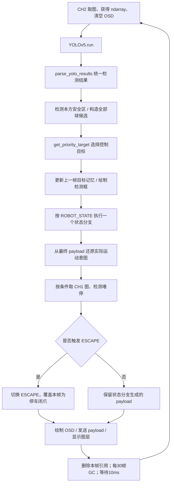
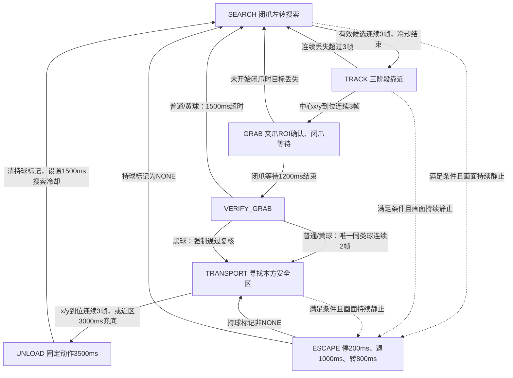

# V8.9 专项说明：识别、抓取、运输、卸载与挣脱全流程

对应源码：[vision_V8.9.py](../src/yolo/vision_V8.9.py)，共 1612 行。本文按 2026-11-07 整理时的原文件解释，相关实现以代码行号或行范围标注。后续修改源码后，行号可能变化。

V8.9 是 **K230 上的纯 YOLO 球类视觉控制程序**：识别球与安全区，生成任务状态，再把运动意图、目标坐标和夹爪动作发送给 STM32。它没有决赛 V2.x 的 OpenCV HSV 黑方块/黄锥识别通路。相机 CH1 用于堵停检测，不用于 HSV 物料识别。

本文只解释现存代码，未进行整车实机验证，也未修改源码。[返回总 README](../README.md) · [版本演进](CODE_VERSION_TIMELINE.md)

## 1. 程序从哪里开始执行

程序没有 `main()`。模块加载后依次执行导入、参数与全局变量初始化、类/函数定义，然后进入 **927 行的顶层 `try`**，初始化硬件，在 **1000 行的 `while True`** 中持续运行。

| 代码区域 | 内容 | 定位 |
|---|---|---|
| 18～208 行 | 模型、队伍、阈值、抓取、运输与串口参数 | 参数 |
| 211～260 行 | 命令枚举、状态编号、堵停阈值 | 状态定义 |
| 263～345 行 | `StuckDetector` 类 | 运动检测 |
| 347～405 行 | 状态、计数器、时间戳、当前持球类型 | 全局变量 |
| 408～637 行 | 通信、显示、ROI 与抓取复核函数 | 工具函数 |
| 640～924 行 | YOLO 解析、目标筛选、安全区与绘图 | 视觉处理 |
| 927～999 行 | 摄像头/显示/模型/串口初始化 | 初始化入口 |
| 1000～1052 行 | 每帧识别、候选选择、调试量初始化 | 循环入口 |
| 1053～1452 行 | 七状态的任务逻辑 | 状态机 |
| 1454～1502 行 | 状态动作完成后，检查堵停并覆盖本帧命令 | 全局挣脱触发 |
| 1504～1589 行 | OSD、发送命令、释放本帧引用和垃圾回收 | 输出阶段 |
| 1591～1612 行 | 异常打印与资源清理 | 退出清理 |

## 2. 输入、输出与启动配置

### 2.1 三通道图像各自负责什么

初始化实现见 929～955 行。

| 通道 | 尺寸和格式 | 使用方式 |
|---|---|---|
| CH0 / `DISPLAY_CHN` | 800×480，YUV420SP | 直接绑定 `Display.LAYER_VIDEO1`，提供背景预览 |
| CH1 / `MOTION_CHN` | 320×240，RGB565 | 满足监测条件且达到 200 ms 间隔才取图，供图像差分 |
| CH2 / `YOLO_CHN` | 800×480，RGBP888 | 每个主循环取图，用 `to_numpy_ref()` 得到推理输入 |
| 独立 OSD 图层 | 800×480，ARGB8888 | 画检测框、夹爪 ROI、状态、真实 sign 等信息 |

摄像头为 `sensor_id=1`，屏幕初始化为 ST7701。显示背景直连 CH0；检测框与文字通过 OSD 叠加，不把框写回 YOLO 输入。

### 2.2 模型与任务配置

50～74 行设置模型路径 `/sdcard/model/best_0719.kmodel`、模型输入 `[320,320]`、置信度 0.4、NMS 0.45、最大框数 50。模型由 957～970 行创建并配置预处理。800×480 是相机/显示坐标尺寸，320×320 是模型输入尺寸；脚本没有自己实现模型内部预处理和 NMS，而是交给固件 `YOLOv5`。

当前有效队伍配置是 **`TEAM_COLOR = "RED"`**（81 行），本方普通球为红球，本方运输安全区为 `redboard`。

| 模型标签 | 控制类型 | 是否可能作为抓取对象 |
|---|---|---|
| `redball` | `NORMAL_RED` | 红队本方球 |
| `blueball` | `NORMAL_BLUE` | 蓝队本方球；当前红队配置会排除 |
| `blackball` | `CORE` | 首个本方普通球复核成功后可选；黑球跳过闭爪后视觉复核 |
| `yellowball` | `DANGER` | 首个本方普通球复核成功后可选；仍需视觉复核 |
| `redboard` / `blueboard` | 安全区框 | 用于运输定位和球候选排除 |
| `redsection` 等其余类别 | 场景检测项 | 当前只用于检测展示/数量统计，未接入任务控制 |

### 2.3 串口与上电动作

408～413 行把引脚 11/12 复用为 UART2 TX/RX；972～979 行实际创建 115200、8N1 的 UART2 句柄。`UART_init()` 本身只设置引脚。

随后 982 行先发送“停车 + 闭爪”，再进入初始状态 `SEARCH`。完整控制脚本会驱动下位机，不是只显示识别结果的测试脚本。

运行环境需由 K230 CanMV 固件提供 `image`、`media.*`、`machine`、`libs.YOLO`、`libs.Utils`、`ulab`；本仓库不包含模型实体和 STM32 接收/执行工程，不能在桌面 Python 中直接运行。

## 3. 每一帧的完整执行链

主循环实现见 1000～1044 行及循环尾部。



这版每帧都运行 YOLO，包括卸载、挣脱、闭爪等待期间。500/1200/3000 ms 等等待通过时间戳与状态判断实现，**没有在对应阶段用长时间 sleep 阻塞主循环**；末尾只有 `sleep_ms(10)`，因此实际帧率还受推理、绘图、串口打印等耗时影响。

状态机是 `if / elif` 链：本帧内将 `ROBOT_STATE` 改成新状态后，通常要到下一帧才执行新状态分支。堵停检查位于整条链之后，能够在同一帧覆盖先前生成的命令。

## 4. 视觉结果如何变成控制目标

### 4.1 检测结果统一：`parse_yolo_results()`

实现：640～766 行。输入是 `yolo.run()` 的返回值，输出是检测字典列表 `dets`。每个字典含：

```python
{
    "x1": ..., "y1": ..., "x2": ..., "y2": ...,
    "w": ..., "h": ..., "cx": ..., "cy": ...,
    "area": ..., "score": ..., "class_id": ..., "label": ...,
    "rect": (x1, y1, w, h)
}
```

- 官方三项结果 `(boxes, class_ids, scores)`：按三组长度的最小值遍历，把 `box=[x,y,w,h]` 明确转换成 `(x,y,x+w,y+h)`，见 694～720 行。这是沿用 V7.9 的坐标修正。
- 其他结果形式：支持字典、五/六元素元组列表、带属性对象。六元素形式用“第一项像类别索引、第二项≤1”区分两种排列，属于启发式兼容，并非任意格式都能自动判断。
- 内部 `append_det()` 做类别索引转标签、坐标转整数、宽高/中心/面积计算，过滤零宽高和不能转换的坐标。面积是**检测框面积**，不是球的真实像素面积。
- 对象兼容分支先把 `w/h` 当成缺失 `x2/y2` 的候选值；仅当它们落在左上角之前时，内部函数才按偏移补偿。因此标准三项结果分支的 xywh 转换是明确实现，不能把所有兼容分支都理解为同样可靠的格式转换。

### 4.2 全部球候选：`get_yolo_ball_targets()`

实现：776～797 行。从 `dets` 中仅保留红/蓝/黑/黄球，并筛选 `50 ≤ area ≤ 80000`，输出包含 `cx/cy/area/type/rect/label` 的轻量字典。此阶段**仍含对方普通球、安全区中的球**；后续选择阶段才过滤。

### 4.3 安全区：运输选择与抓球排除是两套条件

运输安全区由 800～817 行选择：只看本方 `redboard/blueboard`，面积至少 1200，有多个时选框面积最大的。返回中心、`bbox_area`、`rect/outer_rect` 等；无合格框返回 `None`。

球候选排除在 879～893 行：对所有红/蓝安全区检测框各外扩 10 像素，只要球**中心**落入，就排除该球。这里同时过滤双方安全区，且没有复用运输安全区的 1200 面积门槛；不是按球框重叠比例判断。

### 4.4 优先级与同类打分：`get_priority_target()`

实现：864～924 行，顺序为：

1. 排除安全区内球。
2. `FIRST_TARGET_DONE=False` 时只让本方普通球入围；为真后，让本方普通球、黄球、黑球入围，对方普通球始终不入围。
3. 先选**类别权重最高**的类别。当前权重本方普通球 20、黄球 5、黑球 1，因此为本方球→黄球→黑球。
4. 在该类别内部，最大化 `area - abs(cx-400)*60`。同类且与上一帧目标的曼哈顿距离 `<100` 时，加惯性分 20。

例如首次普通球复核成功后，画面同时有红/黄/黑球，在当前红队配置下仍先选红球；移走红球再选黄球，最后才选黑球。一个面积很大的黑球不会越过类别硬优先级。

**目标记忆是软偏好，不是实例锁定。** 1028～1035 行更新上一帧位置与类别；每帧依然重新运行优先级选择。SEARCH 的三帧计数也没有验证每帧是同一个球。进入 GRAB 时只保存 `LOCKED_TARGET_TYPE`，没有保存唯一实例 ID；后续 `control_target` 仍可能变化。惯性加分 20 也不保证压过面积/中心偏移分差。

## 5. 状态机：从搜索到下一轮任务

状态常量见 237～243 行。编号是 SEARCH=0、TRACK=1、GRAB=2、TRANSPORT=3、UNLOAD=4、VERIFY_GRAB=5、ESCAPE=6；编号顺序不等于执行顺序。



### 5.1 SEARCH：闭爪搜索与连续候选确认

代码：1053～1081 行。

- 保持闭爪，清理本次抓取/复核计时与计数，重置运输控制计数。
- 冷却条件为 `ticks_diff(now, search_cooldown_timer) < 1500`。冷却只阻止进入 TRACK，图像识别仍运行，动作仍是闭爪左转。
- 有 `control_target`、面积≥100 且不处于冷却时，`search_target_ready_count` 累加；否则清零。
- 连续 3 帧后切到 TRACK，并在切换当帧发送普通模式“停车 + 闭爪”；未满足时持续“左转 + 闭爪”。

初始 `search_cooldown_timer=0`，所以上电后前 1500 ms 内也可能受这条条件影响，取决于进入循环时系统 tick 已经过了多久。

### 5.2 TRACK：闭爪靠近 → 停车开爪 → 张爪靠近

代码：1083～1185 行。`grab_open_start_time` 同时承担阶段标记和时间戳：

| 变量值 | 实际阶段 | 命令与完成条件 |
|---|---|---|
| `0` | 闭爪靠近 | 发送 `BALL_XY` 球中心。`abs(cx-400)≤80` 且 `cy≥260` 连续 3 帧，停车释放并记录当前 tick |
| `>0` | 停车等待开爪 | 普通模式 STOP+RELEASE，等待≥500 ms，然后标记为 `-1`；该帧仍停车 |
| `-1` | 张爪继续靠近 | 发送 `BALL_XY`。`abs(cx-400)≤80` 且 `cy≥420` 连续 3 帧后进入 GRAB |

进入 GRAB 时保存当前目标类型到 `LOCKED_TARGET_TYPE`、重置抓取计数与时间戳，并停车保持张爪。**420 是 TRACK→GRAB 的位置条件，不是闭爪的最终条件**；闭爪还要经过 GRAB 的 ROI 确认。

没有 `control_target` 时：丢失前 3 帧停车；第 4 帧回 SEARCH。如果之前已开爪，则切换当帧先停车保持张爪，下一帧 SEARCH 再闭爪左转；尚未开爪时直接闭爪左转。

### 5.3 GRAB：先确认进入夹爪，再等待闭爪完成

代码：1187～1234 行。

未开始闭爪时，保持 RELEASE 并检查 `is_target_in_grip_roi(control_target)`。当前 `GRIP_ROI=(332,415,170,62)`，即球中心需要在 x=332～502、y=415～477 范围内，框面积≥1000，连续 3 帧才能 STOP+GRAB 并记录 `grab_close_start_time`。未达确认帧数时继续发送 `BALL_XY` 靠近。

闭爪一旦开始，就不再要求当前目标持续可见：保持停车闭爪，时间达到 1200 ms 后转入 VERIFY_GRAB，启动复核时间戳。尚未开始闭爪而目标丢失时，则停车张爪并回 SEARCH。

这一步 ROI 检查使用的是当前重新选出的 `control_target`，没有检查其类别是否仍等于先前的 `LOCKED_TARGET_TYPE`。GRAB 在“目标一直可见但始终达不到 ROI”时也没有独立总超时；这属于当前实现边界。

### 5.4 VERIFY_GRAB：普通/黄球实测确认，黑球软件放行

代码：1236～1300 行。整个状态默认停车闭爪。

**普通球、黄球：** 调用 `get_verify_grab_result(all_targets, LOCKED_TARGET_TYPE)`。它检查尚未经过优先级和安全区排除的四类球候选：复核 ROI 内必须恰好一个球、框面积≥1000、类型与锁定类型一致。连续两帧满足后通过；任何一帧失败会清确认计数。1500 ms 内未通过则停车松爪，清持球/锁定类型及相关计数，回 SEARCH。

**黑色 CORE 球：** 1242～1249 行不读取 ROI，不等待确认帧，直接构造 `{"type":"CORE"}` 并把确认计数设成门槛值。它仍先从 GRAB 切到 VERIFY_GRAB，下一帧执行这里后进入 TRANSPORT；“跳过确认”是跳过视觉验证，不是删除该状态，也不省略前面的 1200 ms 闭爪等待。

所有通过路径共用 1261～1281 行：

1. `TRANSPORT_COUNT += 1`，保存 `CURRENT_HOLDING_TYPE`。
2. 首次通过的是本方普通球时，设 `FIRST_TARGET_DONE=True`。
3. 切到 TRANSPORT，清抓取/复核计数，重置运输计数，`action_timer=0`。

`FIRST_TARGET_DONE` 表示“首个普通球完成抓取复核”，不是“已运到安全区”。`TRANSPORT_COUNT` 表示开始运输次数，包含黑球绕过复核的路径，不是成功卸载数量。

### 5.5 TRANSPORT：安全区坐标引导与近区超时卸载

代码：1302～1388 行。始终保持闭爪，运输目标是本方颜色且面积最大的有效安全区框。

看到安全区时，发送 `SAFE_XY + FORWARD + GRAB`，坐标为安全区中心，angle=0；判断条件为：

```python
safe_x_ok = abs(safe_x - 400) <= 150
safe_y_ok = safe_y >= 290
```

两者连续 3 帧成立则在当帧发送 `SAFE_XY + STOP + GRAB`，转 UNLOAD 并开始卸载计时。框面积仅用于检测筛选与日志，不用于运输到位判断。

另有近区兜底：横向对准且 `safe_y≥240`（290−50）时开始计时，保持该条件达 3000 ms 后，即使没有达到正常确认要求也转 UNLOAD。横向偏离、退回近区之外或安全区丢失都会清这段计时；不是无条件的全程运输 3 秒超时。

安全区丢失时清到位计数/近区计时：前 2 帧停车闭爪，第 3 帧起左转闭爪寻找，使用普通模式且不再发送旧坐标。这里阈值是 `>=3`，与 TRACK 中“第 4 帧回搜索”的 `>3` 不同。

### 5.6 UNLOAD：3500 ms 固定动作序列

代码：1426～1452 行。所有命令使用普通模式，没有继续用安全区 PID：

| 自进入状态起的累计时间 | 动作 | 夹爪 |
|---|---|---|
| 0～500 ms | 停车 | 闭合 |
| 500～2500 ms | 前进，持续约 2000 ms | 释放 |
| 2500～3500 ms | 后退，持续约 1000 ms | 释放 |
| ≥3500 ms | 停车，回 SEARCH | 当帧仍释放 |

结束时清 `CURRENT_HOLDING_TYPE`、`LOCKED_TARGET_TYPE`，重置运输计数器，记录 `search_cooldown_timer`。下一帧 SEARCH 会闭爪左转，1500 ms 内不允许再进入 TRACK。该过程没有球实际入区或夹爪已空的传感反馈确认。

### 5.7 ESCAPE：图像静止触发的脱困

使能逻辑见 521～548 行。只有以下条件全部满足才检测：

- `FIRST_TARGET_DONE=True`，即首个普通球完成抓取复核后。
- 最终 payload 中运动指令为前进、后退或左右转，状态为 SEARCH/TRACK/TRANSPORT。
- TRACK 还未开始开爪（`grab_open_start_time==0`）；停车开爪与张爪靠近均不检测。
- TRANSPORT 未处于“横向对准且安全区 cy≥240”的近区；近区优先交给卸载超时兜底。

1456～1478 行从最终 payload 解码运动意图，再按 200 ms 间隔取 CH1 图。检测器把 RGB565 图复制灰度化，`mean_pool(4,5)` 得到 80×48，小图与上一张作差，取平均差分值。连续采样差值≤3 达 **2000 ms** 才返回触发；没有编码器或电机电流反馈，所以这是“运动指令下画面长时间静止”的代理判断。

1482～1502 行选择脱困转向、清阶段计数并切 ESCAPE，**触发当帧立即覆盖为停车闭爪**。选择规则是：左转受阻则右转，右转受阻则左转，直行/后退受阻则沿上次方向交替；初始保存方向为右，所以首次直行受阻会选左。

ESCAPE 动作实现见 1390～1424 行：

| 累计时间 | 动作 | 夹爪 |
|---|---|---|
| 0～200 ms | 停车 | 闭合 |
| 200～1200 ms | 后退 1000 ms | 闭合 |
| 1200～2000 ms | 按选定方向旋转 800 ms | 闭合 |
| ≥2000 ms | 停车并结束挣脱 | 闭合 |

结束时若 `CURRENT_HOLDING_TYPE!="NONE"` 则回 TRANSPORT，否则回 SEARCH。这里依据软件持球标记，不是在脱困后重新检查球是否还在夹爪内。图像接口在 `StuckDetector.update()` 内发生异常时，检测器设 `available=False` 并打印原因，主任务继续运行；`reset_observation()` 不会把 `available` 恢复为真。

## 6. 所有类和方法的实现索引

以下覆盖源码中所有顶层函数、类方法与两个嵌套函数。每项注明输入/返回或副作用，避免把固件库方法误认为本文件实现。

### 6.1 枚举类与检测器对象

| 类 | 实现 | 用途 |
|---|---|---|
| `MoveCmd` | 211～217 行 | 保存运动协议数值，无实例方法。 |
| `GripAction` | 220～223 行 | 保存抓取/释放数值，无实例方法。 |
| `VisionMode` | 226～232 行 | 保存 NONE/BALL_XY/SAFE_XY 模式数值，无实例方法。 |
| `StuckDetector` | 263～345 行 | 持有差分历史和挣脱方向；方法详见下表。 |

### 6.2 逐方法索引（26 个顶层函数 + 5 个类方法 + 2 个嵌套函数）

| 方法 / 代码范围 | 输入、输出与副作用 | 实现步骤 |
|---|---|---|
| `StuckDetector.__init__`<br>265～271 行 | 无额外输入；无返回值。 | 建立前一帧、采样 tick、静止 tick、差分值与可用标记；初始挣脱方向右转。 |
| `StuckDetector.reset_observation`<br>273～277 行 | 无返回值；修改对象。 | 清前帧、采样 tick、静止 tick、差分值；保留 available 与上次挣脱方向。 |
| `StuckDetector.choose_escape_turn`<br>279～288 行 | 输入：触发时的运动枚举；无返回值。 | 左右转受阻选相反方向；其他运动按上次方向左右交替，更新 escape_turn_cmd。 |
| `StuckDetector.update`<br>290～340 行 | 输入：CH1 image.Image/None、当前 tick、使能；输出 bool。 | 禁用则清比较历史；每≥200 ms复制灰度图并池化到80×48；与前帧差分，均值≤3持续≥2000 ms返回True。首张只建基准。内部异常关闭检测并返回False。 |
| `StuckDetector.still_elapsed`<br>342～345 行 | 输入：当前 tick；输出毫秒数。 | 无静止起点返回0，否则用 ticks_diff 计算；供 OSD 调试，不触发动作。 |
| `UART_init`<br>408～413 行 | 无返回值；修改硬件复用。 | 创建 FPIOA 并将11/12映射到UART2 TX/RX；UART句柄在主初始化另行创建。 |
| `calculate_crc16`<br>416～425 行 | 输入：字节序列、首尾索引（两端含）；输出16位整数。 | 0xFFFF起始，逐字节异或、每字节8次右移，最低位为1时异或0xA001，最后与0xFFFF。 |
| `clamp_u16`<br>428～434 行 | 输入数值；输出整数。 | int转换并截到0～65535；非数值转换异常不在本函数捕获。 |
| `pack_sign`<br>437～438 行 | 输入：运动、视觉模式、夹爪枚举；输出整数。 | 按mode×100+cmd×10+grip十进制编码；不在这里校验枚举合法性。 |
| `build_frame`<br>441～457 行 | 输入四元组payload；输出13字节bytearray。 | 写55/长度、四个大端u16，对0～9计算CRC并低字节先存，末尾AA；内部调用clamp_u16。 |
| `send_payload`<br>460～462 行 | 输入payload；无返回值，写串口。 | 调用build_frame后uart.write；本身不去重、不节流，也不读取ACK。 |
| `clamp_vision_pos`<br>465～471 行 | 输入数值；输出整数。 | int转换并截到0～4095，供BALL_XY/SAFE_XY坐标使用。 |
| `build_fixed5_payload`<br>474～487 行 | 输入运动/模式/夹爪及可选坐标角度；输出四元组。 | 先生成sign，angle/x/y默认0；BALL_XY写坐标；SAFE_XY写角度和坐标。函数名虽含5，返回4个字段。 |
| `make_normal_payload`<br>490～492 行 | 输入cmd、grip_action；输出四元组。 | 包装NONE模式，坐标/角度清0；用于直接动作和固定时序阶段。 |
| `make_track_payload`<br>495～498 行 | 输入夹爪动作、球中心x/y；输出四元组。 | 固定FORWARD与BALL_XY，坐标交下位机视觉控制；不在本函数中计算轮速。 |
| `make_transport_xy_payload`<br>502～509 行 | 输入运动、夹爪、安全区中心；输出四元组。 | 包装SAFE_XY；未传angle_value所以angle=0，支持FORWARD和到位STOP。 |
| `get_payload_move_cmd`<br>512～518 行 | 输入四元组；输出运动枚举数值。 | 从sign以(sign%100)//10还原；索引/转换出错返回STOP，避免依赖可能过时的外层cmd。 |
| `should_monitor_stuck`<br>521～548 行 | 输入状态、payload、安全区状态/框、开爪标记；输出bool。 | 结合全局FIRST_TARGET_DONE，仅允许指定运动状态；排除开爪后的TRACK与运输安全区近区。只判断使能，不计算图像差分。 |
| `send_payload_if_needed`<br>551～561 行 | 输入payload；无返回值，更新发送历史。 | 与上次不同或已过30ms就调用send_payload；保存tuple副本与发送tick。变化载荷不受30ms限制。 |
| `draw_label`<br>564～568 行 | 输入图像、x/y、文字、颜色；无返回值。 | 固定32号字，先在偏移(1,1)处画黑影，再在原位画彩色文字。 |
| `get_display_label`<br>571～587 行 | 输入模型标签；输出字符串。 | 用映射表转成RED/CORE/SAFE相关显示名；未知标签回退str(label)，不改变控制类型。 |
| `is_target_in_grip_roi`<br>590～602 行 | 输入球候选/None；输出bool。 | None返回False；球中心在GRIP_ROI边界内且框面积≥1000才通过，边界使用≤。 |
| `is_target_in_verify_grab_roi`<br>605～617 行 | 输入球候选/None；输出bool。 | 与前者同样的中心/面积判断，但使用独立VERIFY_GRAB_ROI和VERIFY_GRAB_BALL_MIN_AREA配置。当前默认复用抓取值。 |
| `get_verify_grab_result`<br>620～637 行 | 输入全部球候选、锁定类型；输出(target或None, ROI球数)。 | 遍历复核ROI，要求恰好1个合格球；锁定类型非None时必须一致。未通过时仍返回数量便于调试。 |
| `parse_yolo_results`<br>640～766 行 | 输入模型原始结果；输出检测字典列表。 | 兼容官方三项结果与若干字典/列表/对象形式；官方xywh明确转xyxy，调用嵌套append_det统一字段。None返回空列表。 |
| `parse_yolo_results.append_det`<br>645～692 行 | 输入框端点、分数、类别索引/标签；无显式返回值。 | 内部闭包将合法检测追加到外层dets；转换类别与坐标，处理部分反向端点，滤零宽高，补score=0并计算rect/中心/面积。 |
| `reset_transport_controller`<br>769～773 行 | 无返回值；修改两个全局计数。 | 仅把transport_lost_count与transport_xy_ready_count置0；不会清action_timer、持球标记或状态。 |
| `get_yolo_ball_targets`<br>776～797 行 | 输入统一dets；输出球候选列表。 | 只映射红蓝黑黄四类，滤面积50～80000，保留中心/框/类别；不排除对方球或安全区球。 |
| `detect_safe_zone_from_yolo`<br>800～817 行 | 输入dets；输出本方安全区字典/None。 | 根据TEAM_COLOR筛board标签，面积≥1200，选框面积最大者；outer_rect直接等于检测rect。 |
| `get_sections_from_yolo`<br>820～825 行 | 输入dets；输出场景项列表。 | 提取redsection/bluesection/shizi/redcube/bluecube/greenzhu/yellowtai，当前主循环只统计数量，未驱动避障/导航。 |
| `draw_yolo_detections`<br>828～861 行 | 输入OSD、dets、控制目标、安全区；无返回值。 | 各类检测框/中心按颜色绘制；选中安全区避免重复通用绘制，再专门画SAFE_ZONE；控制目标青色强调。 |
| `get_priority_target`<br>864～924 行 | 输入全部球候选和dets；输出一个候选/None。 | 先排安全区球、按首球门槛/本方类别筛选，再按类别权重硬选择，最后调用score_target择同类最高分。 |
| `get_priority_target.score_target`<br>912～922 行 | 输入同类候选；输出打分。 | 框面积−横向偏离×60；若同上次类型且曼哈顿距离<100则加20。只在已选出的最高权重类别内比较。 |

## 7. 串口命令怎样打包，怎样与下位机配合

### 7.1 枚举与载荷

枚举实现：211～232 行。运动 STOP/FORWARD/BACKWARD/TURN_LEFT/TURN_RIGHT 为 0/1/2/3/4；夹爪 GRAB/RELEASE 为 1/2；视觉模式 NONE/BALL_XY/SAFE_XY 为 0/1/2。

函数之间传递的 `payload` 是四元组 `(sign, angle, pos_x, pos_y)`，并不是五字节数据。`build_fixed5_payload()` 的函数名沿用旧称，实际返回四个 16 位字段。

```text
sign = vision_mode × 100 + move_cmd × 10 + grip_action

普通停车闭爪：  sign =   0×100 + 0×10 + 1 =   1
普通左转闭爪：  sign =   0×100 + 3×10 + 1 =  31
跟踪前进张爪：  sign =   1×100 + 1×10 + 2 = 112
运输前进闭爪：  sign =   2×100 + 1×10 + 1 = 211
运输到位停车：  sign =   2×100 + 0×10 + 1 = 201
```

sign 为十进制组合，不是位掩码；`get_payload_move_cmd()` 用 `(sign % 100)//10` 取运动位。TRACK/TRANSPORT 某些路径只更新 payload，不更新外层 `cmd`，因此堵停检测和 OSD 读取 payload 才能反映真正准备发送的命令。

### 7.2 13 字节帧

实现：441～457 行。

| 字节索引 | 含义 | 编码 |
|---|---|---|
| 0 | 帧头 | `0x55` |
| 1 | 帧总长 | `0x0D`，十进制 13 |
| 2～3 | sign | 无符号 16 位，大端 |
| 4～5 | angle | 无符号 16 位，大端；当前包装函数调用保持 0 |
| 6～7 | pos_x | 无符号 16 位，大端，视觉坐标限制 0～4095 |
| 8～9 | pos_y | 同上 |
| 10～11 | CRC16 | 对 0～9 字节计算，CRC 低字节在前 |
| 12 | 帧尾 | `0xAA` |

CRC 实现初值 `0xFFFF`，逐字节异或，再逐位右移，低位为 1 时异或 `0xA001`。NONE 模式坐标和 angle 都为 0，BALL_XY 带球中心，SAFE_XY 带安全区中心。状态机本身不计算电机 PID，具体视觉坐标如何变成轮速由下位机实现。

### 7.3 发送频率的真实含义

551～561 行的条件是 **`changed or timeout`**：载荷一变就发送；载荷不变时，距上次发送≥30 ms 才重发。因此 30 ms 不是所有帧统一的最小发送间隔，连续变化的坐标帧可能以小于 30 ms 的间隔发送。重发检查每个主循环只执行一次，也不能保证精确每 30 ms 发送。

当前只有 `uart.write()`，没有串口接收、ACK、命令执行结果或舵机位置反馈。“等待开/闭爪完成”是基于固定时间的推定。

## 8. 关键变量如何随流程变化

定义见 347～405 行。

| 变量 | 真实含义与主要更新位置 |
|---|---|
| `ROBOT_STATE` | 当前任务状态；初始 SEARCH，各分支内改变，堵停逻辑可覆盖为 ESCAPE |
| `FIRST_TARGET_DONE` | 首个普通球通过复核后置真（1264～1265），卸载后不清零；同时放开黄/黑球选择和堵停使能 |
| `TRANSPORT_COUNT` | 复核通过/黑球放行后加 1（1262）；只做软件流程统计 |
| `CURRENT_HOLDING_TYPE` | 1263 写入；复核失败与卸载结束清 NONE；决定挣脱后回哪一状态 |
| `LOCKED_TARGET_TYPE` | TRACK→GRAB 时保存类别（1146），复核检查使用；不等于实例级锁定 |
| `last_tracked_cx/cy/type` | 上一帧选中目标，供同类惯性加分；无目标且处于 SEARCH 才清 |
| `grab_ready_count` | 在 TRACK 中先用于“可开爪”三帧计数，再用于“可进 GRAB”三帧计数 |
| `grab_open_start_time` | 0=闭爪靠近，正值=停车开爪等待，-1=张爪继续靠近 |
| `grab_roi_ready_count` | GRAB 内夹爪 ROI 连续确认计数 |
| `grab_close_start_time` | 非零表示已开始闭爪，不再依赖球继续可见 |
| `verify_grab_ready_count/start_time` | 闭爪后二次确认帧数和超时起点 |
| `search_target_ready_count` | 搜索阶段有效候选连续帧数，不校验实例一致性 |
| `transport_lost_count` | TRACK 中统计球丢失，也在 TRANSPORT 中统计安全区丢失，两处边界不同 |
| `transport_xy_ready_count` | 安全区 x/y 到位连续计数 |
| `action_timer` | 按状态复用：运输近区计时、卸载和挣脱的动作起点；运输中 0 表示未开始近区计时 |
| `search_cooldown_timer` | 卸载结束时更新；限制下一次进入 TRACK |
| `last_sent_payload/last_send_time` | 发送去重与同载荷重发计时 |

## 9. 读屏与定位问题时，应以哪些实现为准

OSD 实现见 1504～1580 行：绿色矩形是夹爪 ROI，青色框/连线是当前优先级目标，`STATE/SIGN` 是当前状态与本帧最终载荷的 sign，`EX/TX/TY` 是球中心误差/坐标，`MOTION/STILL` 是平均帧差与连续静止时长。TRANSPORT 另显示安全区中心和到位计数。运输期间屏幕仍可能画出某个球的青色候选框，但真正运动命令已由运输分支使用安全区生成。

| 容易误读的地方 | 源码实际行为与定位 |
|---|---|
| 提前开爪注释写 `y>=350` | 1099 行注释已旧；条件使用 111 行参数，当前实际 `cy>=260` |
| ESCAPE 屏幕阶段不等于实际动作阶段 | 动作在 1395～1403 行按 200/1200/2000 ms 分段；OSD 在 1567～1574 行仍按 200/1600/2500 ms 标记。例如 1300 ms 时实际已转向，屏幕仍可能显示 BACKWARD |
| 安全区注释提到紫色边框 | 160～162 行为遗留说明；当前 `detect_safe_zone_from_yolo()` 只筛本方标签和框面积，没有实现独立紫色边框检测 |
| `SAFE_ZONE_MIN_WIDTH/HEIGHT`、`UNLOAD_CONFIRM_FRAMES` | 定义存在，但未参与当前状态转换条件；卸载由固定时间控制 |
| 惯性加分“碾压”其他分差 | 注释写法不等于数学保证；当前仅加 20，而中心惩罚每像素为 60 |
| `FIRST_TARGET_DONE` / `TRANSPORT_COUNT` | 表示抓取流程通过与开始运输，不证明入区或卸载成功 |
| 黑球 `verify_grab_debug_detected=True` | 由绕过分支直接设置，不是检测到夹爪内黑球的证据 |

### 常见现象到代码的对应关系

| 现象 | 优先核对的实现 |
|---|---|
| 一直左转、不抓黄/黑球 | 首球门槛（895～899）；安全区过滤（885～893）；SEARCH 面积/冷却/连续帧（1065～1072） |
| 接近后停车张爪约半秒 | TRACK 开爪等待（1121～1131），属于预设流程 |
| 到了 y≈420 仍不闭爪 | 已进 GRAB 后还需夹爪 ROI、面积≥1000、连续 3 帧（1207～1222） |
| 普通球抓住后又松开搜索 | 复核要求 ROI 内恰好一个同类球（620～637），超时 1500 ms 则失败（1283～1298） |
| 黑球看不见却进入运输 | CORE 绕过确认（1242～1249），属于 V8.9 的特定策略 |
| 首次发车前不触发挣脱 | `FIRST_TARGET_DONE` 使能限制（524～525） |
| 安全区前顶住后直接卸载 | 近区横向对准、cy≥240 且持续 3000 ms 的兜底（1335～1372） |
| 运输丢区后左转但不松爪 | TRANSPORT 丢失搜索分支（1373～1388） |

## 10. 退出与当前实现边界

1591～1612 行在顶层异常时打印 `Error`，最后依次尝试停止 sensor、释放 yolo、关闭 Display 和 MediaManager，再执行垃圾回收；每个资源清理有独立异常保护。**这里没有额外发送停车帧，也没有显式关闭 UART**，下位机在上位机退出后如何处理，取决于下位机自身协议/超时逻辑，目录内没有它的实现可供确认。

当前没有运输途中持续在手监测、卸载入区确认、编码器式堵转验证或实例级目标锁定。除视觉检测置信度外，动作成功主要由 ROI、连续帧、固定时间和软件持球标记推定。本文按这些实际分支解释行为，不将旧注释、OSD 提示或状态计数视为额外的硬件反馈。


源码校验：本说明对应的 `vision_V8.9.py` SHA-256 为 `cdbafa944c5f0d6d201ee8cb7a2b0b5feec71c07681530f44e6adc8a80be92d3`。
